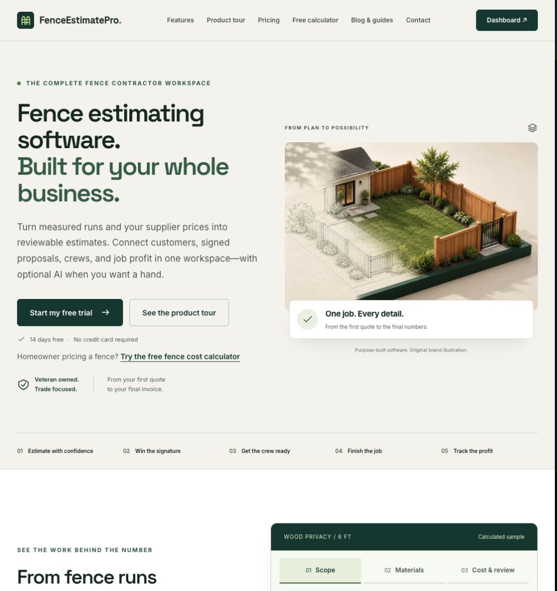

# FenceEstimatePro

A connected workspace for estimating fence jobs and managing the work that follows.

FenceEstimatePro helps fence contractors bring measured layouts, supplier pricing, customers, proposals and job records together. It works in a browser across desktop, tablet and phone. [Explore the product →](https://fenceestimatepro.com/)

## From measurements to job results

1. **Prepare your pricing.** Import supplier lists and review product matches, units and costs before activating them.
2. **Build the estimate.** Enter fence runs and gates, inspect material quantities, and review labor, site conditions and margin.
3. **Agree on the scope.** Share a proposal for customer review and signature.
4. **Coordinate the job.** Keep crew assignments, materials and signed changes connected to the work.
5. **Review the numbers.** Prepare invoices, record receipts and actual costs, and compare the job's results with the estimate.

Optional AI can help prepare scope drafts for review. Everyday estimates and job records work without an AI connection. Feature availability varies by plan.

## See it in action

- [Product tour](https://fenceestimatepro.com/product-tour)
- [Features](https://fenceestimatepro.com/features)
- [Free fence calculator](https://fenceestimatepro.com/calculator)

Founded by Keegan Pearl, U.S. Navy veteran · A Pearl Labs LLC company.

Public product overview · Application source remains private.
